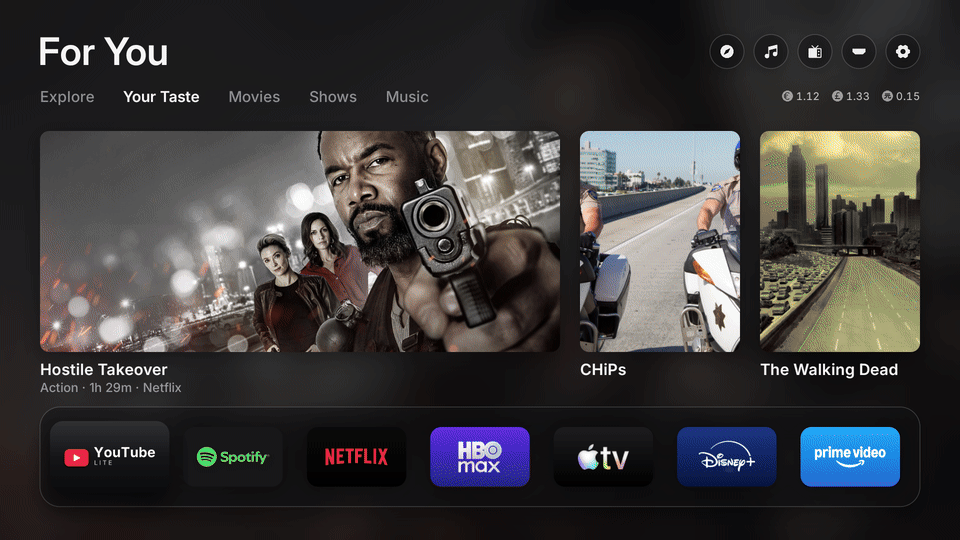
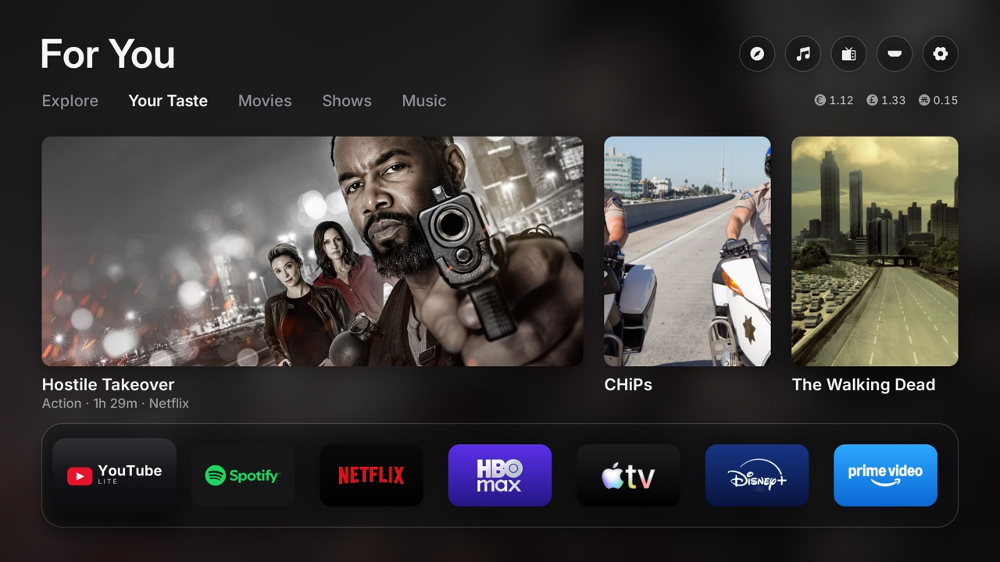
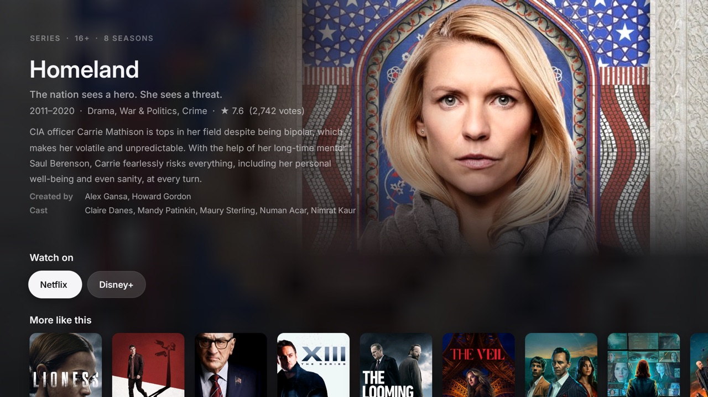
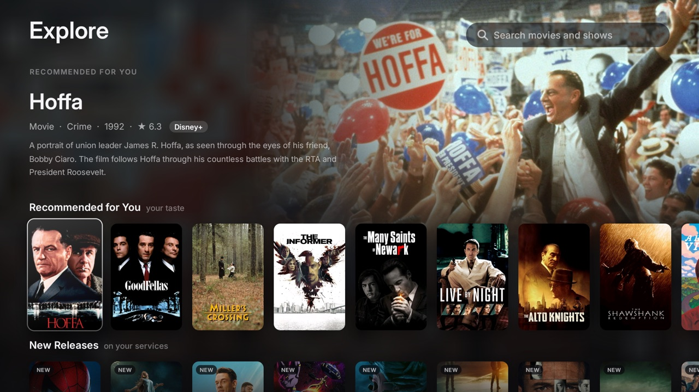
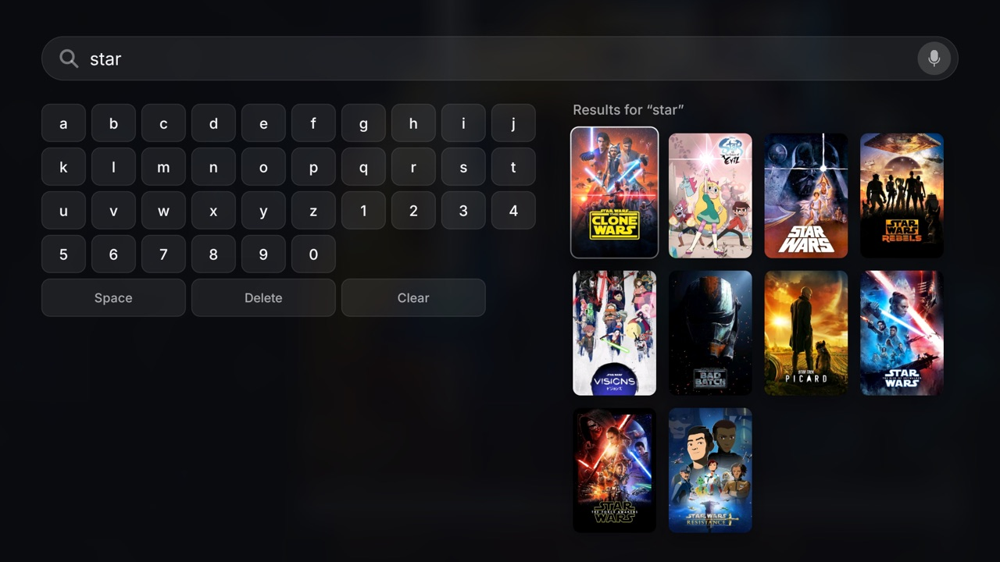
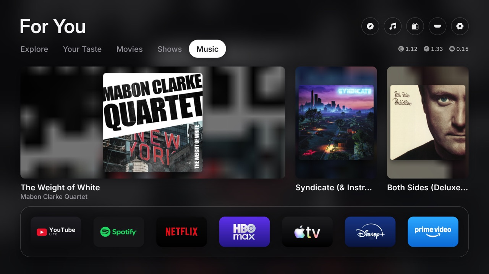
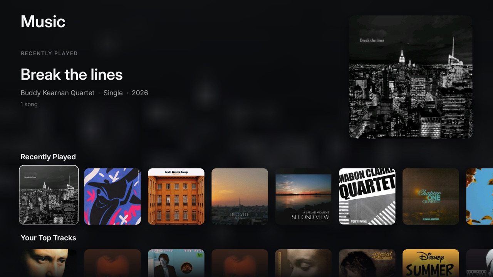
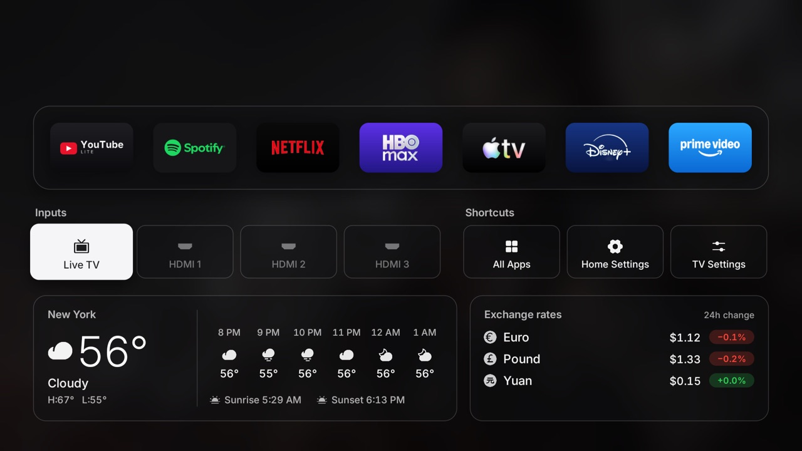
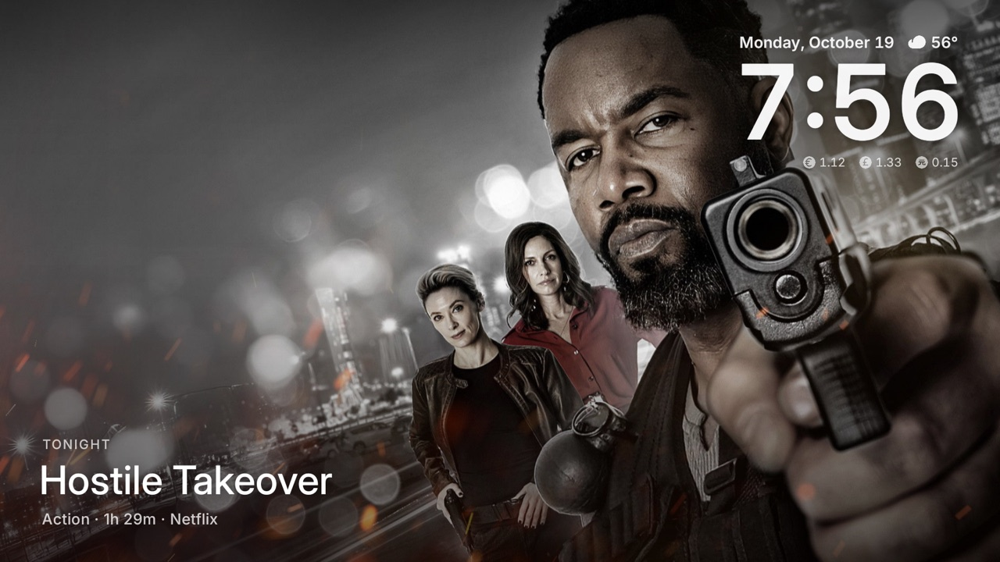

<div align="center">


# Free My TV

**A fast, ad-free home screen for Google TV.**

Trending picks from your own apps, the weather at a glance, and a look that follows the sunset.<br>
Open source. Built with Claude Code. One button to undo.

[**freemytv.io**](https://freemytv.io) · [Install](#install) · [Any TV](#any-tv) · [Make it yours](#make-it-yours) · [This fork](#this-fork)


</div>

## This fork

A fork of [simbasjungles/free-my-tv](https://github.com/simbasjungles/free-my-tv) with a few additions, tested on a TCL Smart TV Pro (Android TV 11). Everything new is optional and stays off until you set it up: type `/setup` in Claude Code and it walks you through all of it.



- **Android 11.** The original needs Android 12; this one runs on 11 too (the glass effects need 13, as before).
- **Every title has a page.** OK on any movie or show (home cards, Explore, search) opens its page first: what it is, who made it, the synopsis and **where to watch it**, with a button per service, and *More like this*.
- **Explore.** The compass button at the top: recommendations for you, new releases, genres, and search (type with the arrows, or hold OK on the microphone and speak). Only what's on your services.
- **Your Taste.** A home tab with picks like the titles you love, in the genres you like (`taste_titles`, `taste_genres`). The home opens on it, and the screensaver shows it.
- **Music.** With Spotify Premium: a Music screen (recently played, your top tracks and artists, their new releases, your playlists and saved albums) and a Music tab on the home screen. OK opens Spotify.
- **YouTube or SmartTube.** `/setup` asks which you want; SmartTube (a lighter YouTube, shown as "YouTube lite") is installed from F-Droid with its signature checked. The shelf's order is yours too (`shelf`).
- **A dark theme** (`theme=dark`), **exchange rates** (dollar, euro, pound, yuan) instead of crypto prices, **Phosphor** icons, the screensaver with **Back** on the home screen, and covers that switch only once they're loaded.

| | |
|---|---|
|  |  |
| **Your Taste** on the home screen | **A title's page**: where to watch it, more like it |
|  |  |
| **Explore**: for you, new releases, genres | **Search**: the TV keyboard, or hold OK on the microphone |
|  |  |
| **Music** on the home screen | **Music**: your Spotify, on its own screen |
|  |  |
| Weather and **exchange rates** | The **screensaver** (Back on the home screen, or idle) |

<sub>Screenshots from a TCL Android TV 11, in the dark theme.</sub>

### Keeping up with the original

```bash
git remote add upstream https://github.com/simbasjungles/free-my-tv   # once
git fetch upstream && git merge upstream/main
```

Each change here is its own commit on top of the original, so a merge shows clearly what's new on either side. The website at freemytv.io (`docs/`) is the original's and is left as it is.

## What you get

- **No ads.** No sponsored rows, banners or autoplaying promos. Not one.
- **Your apps, front and center.** The streaming apps you actually use, on a glass shelf.
- **Trending, not sponsored.** Three fresh picks every hour from what's trending this week and the latest releases, only from apps you already have. Movies and Shows get their own tabs.
- **Explore.** The compass button at the top (or the remote's search key): recommendations for you, new releases, genres and search, only what's on your services. It closes when you leave, so the home screen stays light.
- **Every title has a page.** What it is, who made it, the synopsis, where to watch it (one button per service) and more like it.
- **Your Taste and Music.** Picks like the titles you love; and, with Spotify Premium, your music on its own screen and tab.
- **Weather and exchange rates, one press away.** The hour-by-hour forecast, sunrise and sunset, and exchange rates (dollar, euro, pound and yuan).
- **Light by day, dark by night.** It follows your city's real sunset, the way your phone does.
- **A screensaver to match.** Full-screen photos of the picks with a big glass clock.
- **Fast.** 60 fps, every frame in 16.6 ms, on the TV's own chip. The home screen uses 96 MB of memory instead of 242 MB (−60%).<br><sub>Measured on a 98″ TCL Google TV running Android 14.</sub>
- **Safe.** No root. Nothing is uninstalled. One button brings back the factory home screen.

## Install

About ten minutes. You need a Google TV or Android TV (Android 11 or newer) and a computer on the same Wi-Fi.

### The easy way: Claude Code

1. **On the TV**, turn on developer mode: Settings → System → About → press *Android TV OS build* 7 times. Then Settings → System → Developer options → turn on **USB debugging**. Write down the TV's IP address (Settings → Network & Internet).
2. **On your computer**, get the code:
   ```bash
   git clone https://github.com/johncovv/free-my-tv && cd free-my-tv
   ```
3. **Open [Claude Code](https://claude.com/claude-code) in that folder** and type **`/setup`**. It asks you a few questions, installs the tools it needs, connects to your TV, helps you with the TMDB key and (optionally) your taste, YouTube or SmartTube, and Spotify, builds the app and puts it on your TV. Or just say:
   > Install Free My TV on my TV at 192.168.1.50. I live in Lisbon.
4. **On the TV**, open *Free My TV* → *Home Screen* → *Free My TV*, and accept the debugging prompt (tick *Always allow*).

### The manual way

1. **On the TV**, do step 1 above.
2. **Tools:** a JDK (17+), the Android SDK command-line tools (build-tools 34, platform android-34) and adb. On a Mac:
   ```bash
   brew install --cask temurin android-commandlinetools android-platform-tools
   sdkmanager "build-tools;34.0.0" "platforms;android-34"
   ```
   On Linux, get OpenJDK 17, Android's command-line tools and adb from your package manager, then run the same `sdkmanager` line. On Windows, use WSL.
3. **Build:**
   ```bash
   ./build.sh
   ```
   The first run creates `config.properties`. Set your city and your [TMDB key](#the-tmdb-key) there, then run it again.
4. **Install:**
   ```bash
   adb connect 192.168.1.50:5555
   adb install -r FreeMyTV.apk
   ```
5. **On the TV**, open *Free My TV* → *Home Screen* → *Free My TV*.

## Settings

Everything lives in `config.properties`, created by the first build:

| Key | What it does | Default |
|---|---|---|
| `tmdb_key` | Your free TMDB key, for the picks | empty |
| `tmdb_region` | Your country (two letters): which titles are on which app | `US` |
| `latitude`, `longitude` | Your city, for the weather and the sunset | New York |
| `city` | The name on the weather card | `Weather` |
| `language` | `auto` (follows the TV), `en` or `pt` | `auto` |
| `currency` | Exchange rates in `BRL`, `USD`, `EUR`… | `USD` |
| `temperature` | `C`, `F` or `auto` | `auto` |
| `theme` | `auto` (follows the sunset), `dark` or `light` | `auto` |
| `shelf` | The shelf's apps, in order: `smarttube,netflix,max`… | the default order |
| `taste_titles` | Titles you love, comma-separated: the "Your Taste" tab | empty (no tab) |
| `taste_genres` | Genres you like: `ação, guerra` or `action, war`… | empty |
| `spotify_client_id` | Your Spotify app's Client ID: the Music screen and tab ([below](#spotify)) | empty (no music) |
| `spotify_refresh_token` | Written by `tools/spotify_login.py` | empty |
| `disable_assistant` | Also turn off Google Assistant | `false` |

Changed something? Run `./build.sh` and install again. Keep `freemytv.keystore`: updates are signed with it.

### The TMDB key

Free, and it takes two minutes: create an account at [themoviedb.org](https://www.themoviedb.org/signup), then open [Settings → API](https://www.themoviedb.org/settings/api) and request a developer key. Paste the *API Read Access Token* (or the *API Key*) after `tmdb_key=`. It's your key: `config.properties` stays out of git.

### Spotify

Needs Spotify Premium (Spotify's rule for personal apps since 2026). At [developer.spotify.com/dashboard](https://developer.spotify.com/dashboard), create an app with the Redirect URI `http://127.0.0.1:8888/callback` and *Web API* ticked. Put its Client ID after `spotify_client_id=`, then run `python3 -I tools/spotify_login.py`: it opens the browser, you authorize (read-only: top items, recently played, playlists, saved albums), and it writes the token to `config.properties`. Build and install again. Spotify's own "Made for you" mixes aren't open to apps, so the picks come from your listening.

### TCL TVs: let it start on its own

TCL's Android blocks background jobs of apps that weren't installed from the store, so switching to *Free My TV* snaps back to *Original*. Allow it once, from the computer:

```bash
adb shell appops set io.freemytv APP_AUTO_START allow
```

## Going back

On the TV: *Free My TV* → *Home Screen* → *Original*. The factory home screen, screensaver and every app come back exactly as they were. If the new home screen ever crashes three times in five minutes, it switches back by itself.

To remove it for good, switch to *Original* first, then uninstall *Free My TV* (Settings → Apps).

## What it changes

- It becomes the home screen and the screensaver.
- It turns off, without uninstalling:
  - the stock home screen and screensaver, with the remote shortcuts they run on some TVs (like the Netflix button on TCL);
  - Google TV's recovery home, Play Games and YouTube Music;
  - on TCL TVs, the TCL Channel, messages, store demo, hotel menu, manuals, mirroring and logging apps;
  - Google Assistant, only with `disable_assistant=true`.
- Picture, sound, inputs, remote pairing, Google services and the Play Store are on a protected list, checked before every change.

## Any TV

Free My TV runs on Google TV and Android TV: TCL, Sony, Hisense, Philips, Xiaomi and more, plus streamers like Chromecast with Google TV, the Google TV Streamer, onn 4K and NVIDIA Shield.

**Samsung, LG or any other TV:** plug a Google TV streamer into HDMI and free that one. Same steps, same home screen.

**A different brand or model:** ask Claude. Free My TV is made to be adapted by AI. Open the folder in Claude Code and say *"set it up for my Sony"*: it reads your TV, finds its home screen and its promo apps, updates the lists below and walks you through a test. [CLAUDE.md](CLAUDE.md) tells it how.

| What | Where |
|---|---|
| Apps to turn off | `DEBLOAT` in [`HomeMode.java`](app/src/io/freemytv/HomeMode.java) |
| Apps never to touch | `PROTECTED` in the same file |
| Apps on the shelf | `SHELF` in [`HomeApps.java`](app/src/io/freemytv/HomeApps.java) |
| Your brand's live TV app | `LIVE_TV_APPS` in the same file |

## Make it yours

It's your code, and Claude Code finds its way around it. Try:

- *"Add Crunchyroll to the shelf."*
- *"Show the exchange rates in euros."*
- *"Add Spanish."*
- *"Switch to the night look an hour after sunset."*

## How it works

- **A plain Android app, no Gradle, no libraries.** [`build.sh`](build.sh) runs aapt2 → javac → d8 → zipalign → apksigner and makes a 2 MB APK.
- **It uses the TV's own ADB, from inside the TV.** The app connects to `127.0.0.1:5555` with its own key (that's the *Allow USB debugging?* prompt) and runs the same commands you would: `cmd package set-home-activity`, `settings put secure screensaver_components`, `pm disable-user`. Nothing listens to the network.
- **Drawn by hand on one Canvas**, with Android 13 shaders for the frosted glass and the sky (plain fills on Android 11 and 12).
- **Extra screens only while open.** Explore, a title's page and Music are separate screens with small images; leaving one closes it and frees its memory, so the home screen stays as light as before.
- **A safety net.** A watchdog in a separate process brings back the stock home screen after three crashes in five minutes, and a boot check keeps your choice after TV updates.
- **Data** from TMDB (trending titles, new releases, details and which app streams what in your country), Open-Meteo (forecast, sunrise and sunset), AwesomeAPI (exchange rates and their 24-hour change) and, if you connect it, Spotify (your music).

| File | What it is |
|---|---|
| [`HomeView.java`](app/src/io/freemytv/HomeView.java) | The home screen |
| [`HomeMode.java`](app/src/io/freemytv/HomeMode.java) | Switching between Free My TV and Original |
| [`Adb.java`](app/src/io/freemytv/Adb.java) | The TV's own ADB, from inside the TV |
| [`Recs.java`](app/src/io/freemytv/Recs.java) | The picks (TMDB) |
| [`HomeData.java`](app/src/io/freemytv/HomeData.java) | Weather and prices |
| [`HomeApps.java`](app/src/io/freemytv/HomeApps.java) | The shelf, inputs and All Apps |
| [`DreamView.java`](app/src/io/freemytv/DreamView.java) | The screensaver |
| [`SettingsActivity.java`](app/src/io/freemytv/SettingsActivity.java) | The settings screen (the app's icon) |
| [`Watchdog.java`](app/src/io/freemytv/Watchdog.java) | The safety net |
| [`ExploreView.java`](app/src/io/freemytv/ExploreView.java) | Explore: recommendations, new releases, genres, search |
| [`DetailsView.java`](app/src/io/freemytv/DetailsView.java) | A title's page and where to watch it |
| [`MusicView.java`](app/src/io/freemytv/MusicView.java), [`Spotify.java`](app/src/io/freemytv/Spotify.java) | Music, from your Spotify account |
| [`Cards.java`](app/src/io/freemytv/Cards.java) | Posters, photos and the card focus shared by those screens |

The website ([freemytv.io](https://freemytv.io)) is in [`docs/`](docs): plain HTML, CSS and JS on GitHub Pages.

## Privacy

No accounts, no analytics, no tracking. The app only talks to TMDB, Open-Meteo (with the coordinates you set), AwesomeAPI and, only if you connect it, Spotify (read-only). Voice search uses the TV's own speech recognition, only while you hold OK on the microphone. Your settings and keys stay on your computer and your TV (`config.properties` is never committed). They're built into `FreeMyTV.apk`, so don't share your APK: friends build their own with `/setup`.

## Credits

- Built with [Claude Code](https://claude.com/claude-code).
- This product uses the TMDB API but is not endorsed or certified by [TMDB](https://www.themoviedb.org/).
- Weather data by [Open-Meteo.com](https://open-meteo.com/) (CC BY 4.0). Exchange rates from [AwesomeAPI](https://docs.awesomeapi.com.br/).
- Icons: [Phosphor](https://phosphoricons.com) (MIT). Font: [Inter](https://rsms.me/inter/) (SIL OFL 1.1).
- Music from your account through the [Spotify Web API](https://developer.spotify.com/documentation/web-api); not affiliated with Spotify.
- [SmartTube](https://github.com/yuliskov/SmartTube) is an independent app (installed separately, from F-Droid).
- Not affiliated with Google, TCL or any streaming service. App names and logos belong to their owners.

## License

[MIT](LICENSE). Fork it, change it, ship it.
